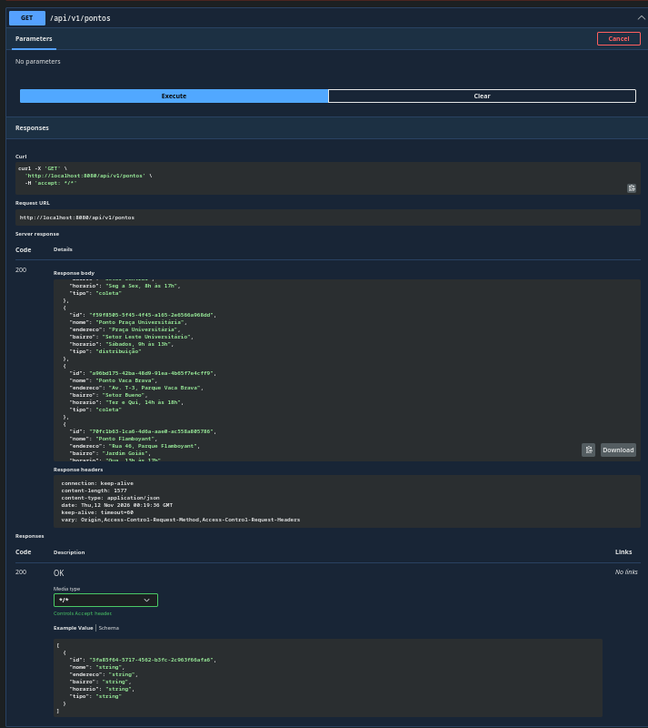
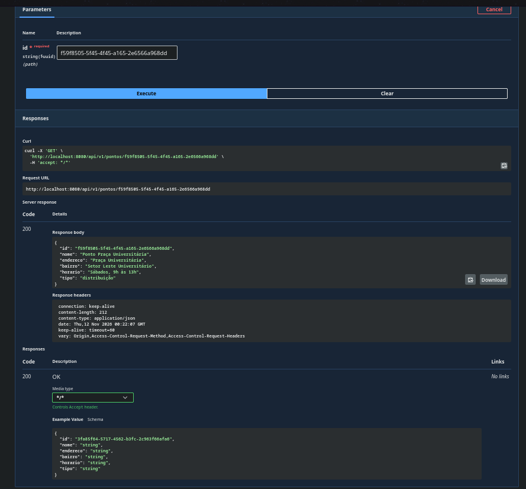
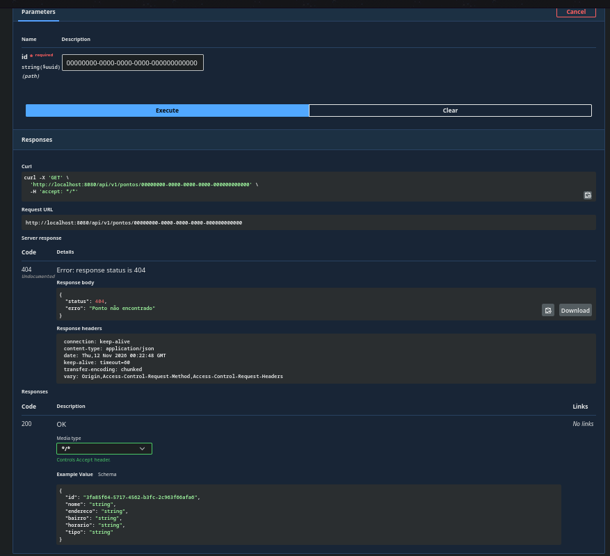
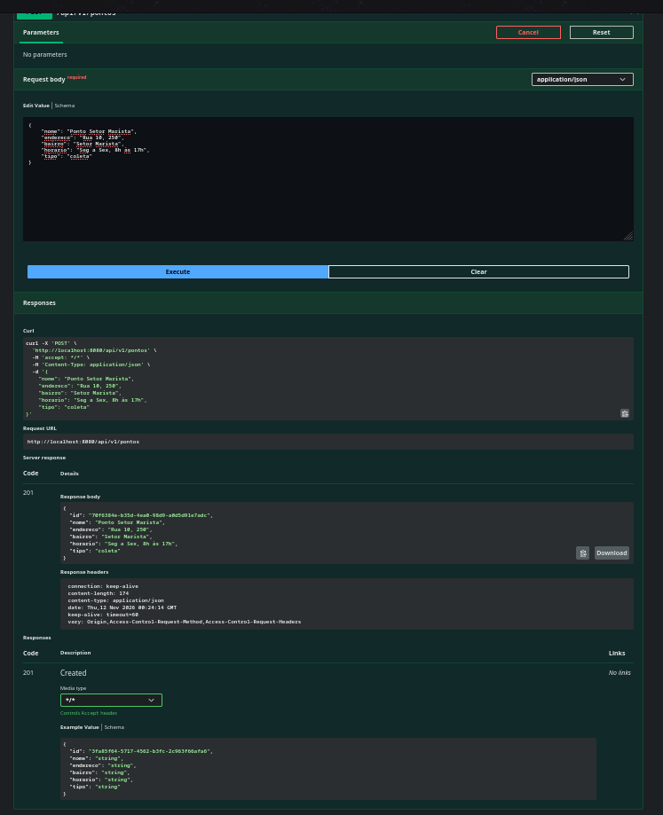
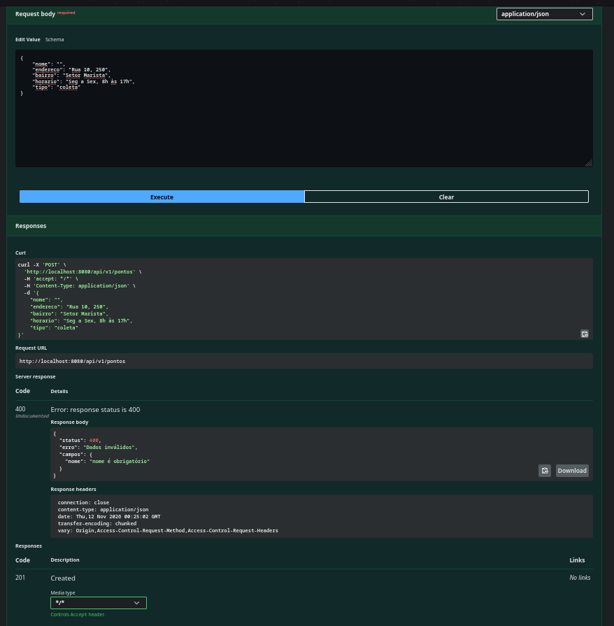
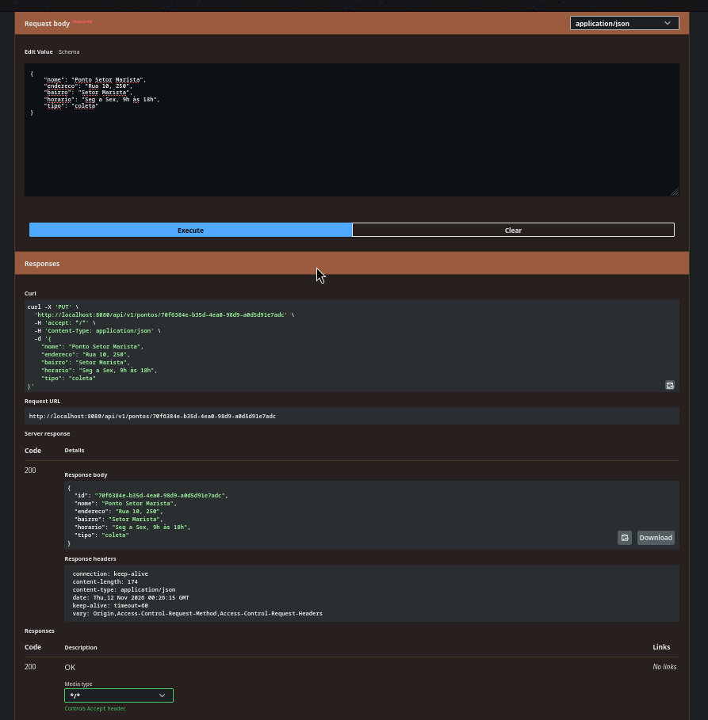
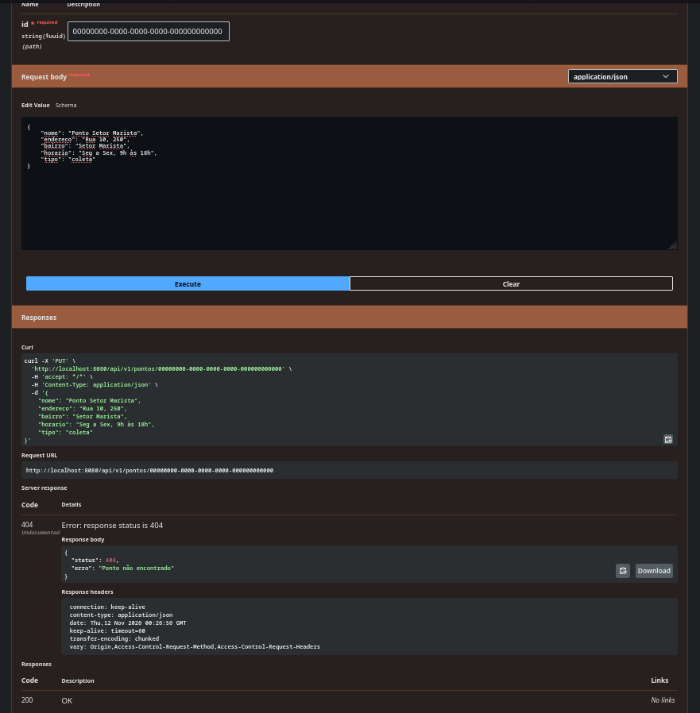
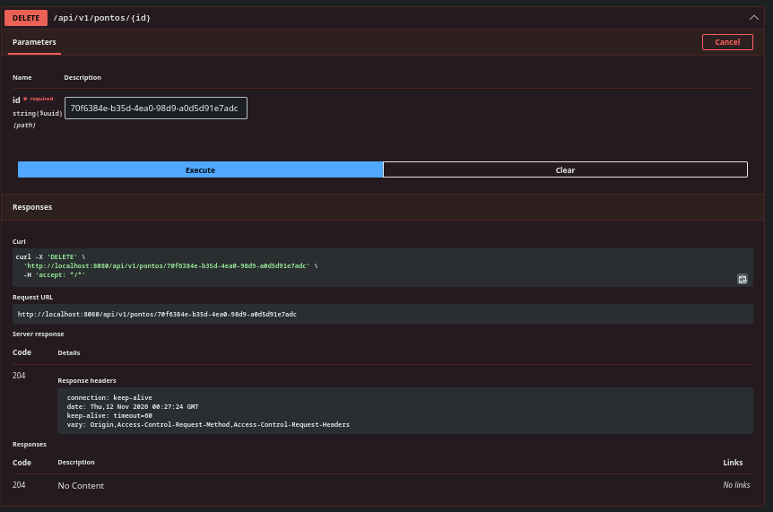

API Instituto Mão Amiga

API do Instituto Mão Amiga com o CRUD dos pontos de coleta e distribuição.
Feita com Spring Boot, Spring Data JPA, H2 (gravando em arquivo, na pasta data/), Lombok, Bean Validation e Swagger (springdoc-openapi).

Para rodar: ./mvnw spring-boot:run
A API sobe na porta 8080. Ao iniciar, são cadastrados 25 pontos em Goiânia (os que já existem não são repetidos).

Swagger: http://localhost:8080/swagger-ui/index.html
Console do H2: http://localhost:8080/h2-console (JDBC URL jdbc:h2:file:./data/maoamiga, usuário sa, sem senha)


Endpoints

GET http://localhost:8080/api/v1/pontos
Lista todos os pontos. Responde 200.


GET http://localhost:8080/api/v1/pontos/{id}
Busca um ponto pelo id. Responde 200, ou 404 se o id não existir.



POST http://localhost:8080/api/v1/pontos
Cadastra um ponto. Responde 201, ou 400 se algum campo obrigatório estiver vazio (e nada é gravado).



PUT http://localhost:8080/api/v1/pontos/{id}
Edita um ponto. Responde 200, 404 se o id não existir, ou 400 se algum campo obrigatório estiver vazio.



DELETE http://localhost:8080/api/v1/pontos/{id}
Exclui um ponto. Responde 204, ou 404 se o id não existir.



Exemplo de corpo para POST e PUT

{
  "nome": "Ponto Setor Marista",
  "endereco": "Rua 10, 250",
  "bairro": "Setor Marista",
  "horario": "Seg a Sex, 8h às 17h",
  "tipo": "coleta"
}

Todos os campos são obrigatórios. O tipo deve ser "coleta" ou "distribuição".


Busca paginada

GET http://localhost:8080/api/v1/pontos/filtro?filtro=...&page=0&size=10
Procura o texto no nome ou no bairro do ponto, sem diferenciar maiúsculas. Sem filtro, devolve todos.
Por padrão vem 10 por página, ordenados por nome. Para mudar a ordem: sort=bairro,asc

Sem filtro:
GET http://localhost:8080/api/v1/pontos/filtro

```json
{
  "content": [
    {
      "id": "86165bf1-f712-4267-a9f0-f43fd3a2b2c4",
      "nome": "Ponto Aeroporto",
      "endereco": "Av. Independência, 3100",
      "bairro": "Setor Aeroporto",
      "horario": "Seg a Sex, 13h às 18h",
      "tipo": "coleta"
    },
    {
      "id": "d87968b9-57ef-49e1-846e-731e849d24dc",
      "nome": "Ponto Areião",
      "endereco": "Av. Areião, Parque Areião",
      "bairro": "Setor Pedro Ludovico",
      "horario": "Sex, 8h às 11h",
      "tipo": "coleta"
    },
    {
      "id": "f652b5cf-9856-4e04-af9d-c705920bdc43",
      "nome": "Ponto Assis Chateaubriand",
      "endereco": "Av. Assis Chateaubriand, 400",
      "bairro": "Setor Oeste",
      "horario": "Qua, 9h às 12h",
      "tipo": "distribuição"
    },
    {
      "id": "01aa0c4c-fbef-4016-b9c8-575e0ee0c1b6",
      "nome": "Ponto Bosque dos Buritis",
      "endereco": "Rua 1, Bosque dos Buritis",
      "bairro": "Setor Oeste",
      "horario": "Seg e Qua, 9h às 12h",
      "tipo": "distribuição"
    },
    {
      "id": "fc67ddde-6d38-49ab-8d25-eb1b96c2db60",
      "nome": "Ponto Bueno T-63",
      "endereco": "Av. T-63, 1100",
      "bairro": "Setor Bueno",
      "horario": "Seg a Sex, 10h às 16h",
      "tipo": "coleta"
    },
    {
      "id": "612aaf6a-f188-4c48-9366-7f554a6cb873",
      "nome": "Ponto Campinas",
      "endereco": "Av. 24 de Outubro, 800",
      "bairro": "Setor Campinas",
      "horario": "Sáb, 8h às 12h",
      "tipo": "distribuição"
    },
    {
      "id": "e5013286-58dd-4fd2-8b7e-378f4e01f238",
      "nome": "Ponto Campus Samambaia",
      "endereco": "Av. Esperança, Campus Samambaia",
      "bairro": "Chácaras de Recreio Samambaia",
      "horario": "Sábados, 8h às 12h",
      "tipo": "coleta"
    },
    {
      "id": "a93154f8-fe75-4e28-bd8e-00eb9b07e8c6",
      "nome": "Ponto Coimbra",
      "endereco": "Av. Castelo Branco, 2200",
      "bairro": "Setor Coimbra",
      "horario": "Seg a Sex, 8h às 17h",
      "tipo": "coleta"
    },
    {
      "id": "cab4d02a-6125-48b9-81e3-9998b36801c8",
      "nome": "Ponto Criméia Leste",
      "endereco": "Av. Bernardo Sayão, 1300",
      "bairro": "Setor Criméia Leste",
      "horario": "Ter e Qui, 13h às 17h",
      "tipo": "coleta"
    },
    {
      "id": "e1238397-51cf-4732-b71b-51c725fd4427",
      "nome": "Ponto Faiçalville",
      "endereco": "Av. Milão, 150",
      "bairro": "Setor Faiçalville",
      "horario": "Sáb, 8h às 11h",
      "tipo": "coleta"
    }
  ],
  "page": {
    "size": 10,
    "number": 0,
    "totalElements": 25,
    "totalPages": 3
  }
}
```

Filtrando por bairro:
GET http://localhost:8080/api/v1/pontos/filtro?filtro=oeste

```json
{
  "content": [
    {
      "id": "f652b5cf-9856-4e04-af9d-c705920bdc43",
      "nome": "Ponto Assis Chateaubriand",
      "endereco": "Av. Assis Chateaubriand, 400",
      "bairro": "Setor Oeste",
      "horario": "Qua, 9h às 12h",
      "tipo": "distribuição"
    },
    {
      "id": "01aa0c4c-fbef-4016-b9c8-575e0ee0c1b6",
      "nome": "Ponto Bosque dos Buritis",
      "endereco": "Rua 1, Bosque dos Buritis",
      "bairro": "Setor Oeste",
      "horario": "Seg e Qua, 9h às 12h",
      "tipo": "distribuição"
    },
    {
      "id": "add76d13-e467-4799-93f7-02d08c3bc96c",
      "nome": "Ponto Lago das Rosas",
      "endereco": "Av. Anhanguera, Lago das Rosas",
      "bairro": "Setor Oeste",
      "horario": "Ter, 15h às 18h",
      "tipo": "distribuição"
    }
  ],
  "page": {
    "size": 10,
    "number": 0,
    "totalElements": 3,
    "totalPages": 1
  }
}
```

Segunda página:
GET http://localhost:8080/api/v1/pontos/filtro?page=1

```json
{
  "content": [
    {
      "id": "70fc1b63-1ca6-4d6a-aae0-ac558a805786",
      "nome": "Ponto Flamboyant",
      "endereco": "Rua 46, Parque Flamboyant",
      "bairro": "Jardim Goiás",
      "horario": "Qua, 13h às 17h",
      "tipo": "coleta"
    },
    {
      "id": "01529f20-47d0-48fc-b6b2-08f25af86f79",
      "nome": "Ponto Jardim América",
      "endereco": "Av. C-4, 1500",
      "bairro": "Jardim América",
      "horario": "Qua e Sex, 14h às 18h",
      "tipo": "coleta"
    },
    {
      "id": "d518f76b-1cdd-4b12-9ca6-b5e5c368c71d",
      "nome": "Ponto Jardim Europa",
      "endereco": "Av. Europa, 600",
      "bairro": "Jardim Europa",
      "horario": "Qua e Sáb, 9h às 12h",
      "tipo": "coleta"
    },
    {
      "id": "028e3507-077a-4dfa-8c6a-a6feaa7e744a",
      "nome": "Ponto Jardim Guanabara",
      "endereco": "Av. Guanabara, 700",
      "bairro": "Jardim Guanabara",
      "horario": "Sex, 14h às 18h",
      "tipo": "distribuição"
    },
    {
      "id": "add76d13-e467-4799-93f7-02d08c3bc96c",
      "nome": "Ponto Lago das Rosas",
      "endereco": "Av. Anhanguera, Lago das Rosas",
      "bairro": "Setor Oeste",
      "horario": "Ter, 15h às 18h",
      "tipo": "distribuição"
    },
    {
      "id": "565d4e8a-f919-4b1b-b45e-8f6a021c88f1",
      "nome": "Ponto Marista",
      "endereco": "Av. 85, 1200",
      "bairro": "Setor Marista",
      "horario": "Seg a Sex, 9h às 17h",
      "tipo": "coleta"
    },
    {
      "id": "84e425a5-927f-4d62-8d1b-007c196757e7",
      "nome": "Ponto Norte Ferroviário",
      "endereco": "Av. Goiás Norte, 2000",
      "bairro": "Setor Norte Ferroviário",
      "horario": "Seg a Sex, 7h às 11h",
      "tipo": "distribuição"
    },
    {
      "id": "93862bd4-d05b-4d4b-8b4d-cb4ee57bb56a",
      "nome": "Ponto Nova Suíça",
      "endereco": "Av. T-9, 2500",
      "bairro": "Setor Nova Suíça",
      "horario": "Qui, 8h às 12h",
      "tipo": "coleta"
    },
    {
      "id": "d6d7840d-81f5-442d-a2d8-47bd2f248b43",
      "nome": "Ponto Novo Mundo",
      "endereco": "Av. Nova York, 900",
      "bairro": "Jardim Novo Mundo",
      "horario": "Sáb, 9h às 13h",
      "tipo": "distribuição"
    },
    {
      "id": "483c45f0-3bf5-4890-9a5e-ed4566c6bcff",
      "nome": "Ponto Parque Amazônia",
      "endereco": "Av. Rio Verde, 1800",
      "bairro": "Parque Amazônia",
      "horario": "Seg e Qua, 14h às 17h",
      "tipo": "coleta"
    }
  ],
  "page": {
    "size": 10,
    "number": 1,
    "totalElements": 25,
    "totalPages": 3
  }
}
```
